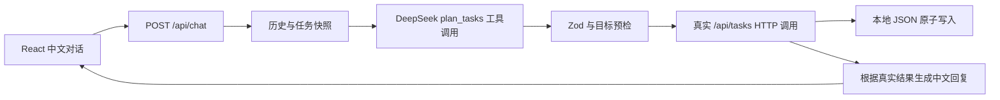

# 小明智能体 · 待办清单编程题

> 下方保留招聘方原题要求；本次实现、启动、测试和限制见后面的「实现与运行说明」。`SUBMIT.md` 由候选人自行填写，本次未编辑。

请把小明改造成一个待办清单智能体，让用户用中文对话管理自己的任务。项目已经提供聊天界面、可持久化的任务 API 和 DeepSeek 客户端。

原始模板初次启动时，无论你说什么，小明都会回复「你好，欢迎使用小明智能体」。当前实现需要配置 DeepSeek 密钥才能使用自然语言任务管理；未配置时会明确提示，不会伪造执行结果。

## 基础要求

请让用户能通过聊天完成创建、查看、标记完成和删除这四种操作。任务应保存到本地，刷新页面或重启服务后仍可查询。

可以从 [server/agent.ts](server/agent.ts) 开始，在这里接收对话历史并返回本轮回复。

任务接口的路径、字段和返回值见 [OpenAPI 说明](server/openapi.yaml)。

下面是一段验收对话。

| 用户对小明说     | 预期结果                                   |
| ---------------- | ------------------------------------------ |
| 帮我记一下买牛奶 | 新增待办「买牛奶」                         |
| 再记一条取快递   | 清单里多了一条「取快递」                   |
| 我有哪些任务？   | 列出两条任务，并能看出各自的完成状态       |
| 牛奶买好了       | 把「买牛奶」标记为已完成，「取快递」仍待办 |
| 取快递这条删掉吧 | 删除「取快递」                             |
| 再给我看看清单   | 只剩已完成的「买牛奶」                     |

## 可选扩展

以下扩展功能可选做，有的任务描述刻意写得比较模糊。

- 回答「今天有哪些任务到期？」
- 创建并管理子任务
- 改进清单的展示，让用户更容易看出哪些任务还需要处理。
- 为任务增加优先级和工作量（如小、中、大）。
- 你认为合适的任何功能或优化

## 评价标准

- SUBMIT.md（见提交要求）
- 对代码仓库的理解程度
- 功能的完成度
- 边界情况的考量
- 完成扩展功能数量

## 快速开始

安装 Node.js 24.12 或更高版本，在项目根目录运行以下命令。

```sh
npm ci
npm run dev
```

打开 <http://127.0.0.1:3000>，发送一条消息即可看到初始回复。接入模型时，把 `.env.example` 复制为 `.env`，填写自己的 `DEEPSEEK_API_KEY`，再重启服务。详细步骤见[本地开发指南](GETTING_STARTED.md)。

## 模型费用

完成本题所产生的 DeepSeek API 实际调用费用可报销，**每人最多人民币 20 元**。运行初始项目和测试任务 API 无需密钥，也不会产生模型费用。请将密钥保存在本地 `.env` 中。

## 提交

提交包含以下三个部分，发送至hr@tokenow.com.cn。

- [ ] 代码仓库链接（请确保是公开的）
- [ ] 仓库内的SUBMIT.md，不需要单独提交。**请尽可能避免使用AI工具编辑SUBMIT.md**
- [ ] （可选）录制一个简单视频，模拟用户与智能体交互的情景。

---

## 实现与运行说明

小明使用原项目的 React 聊天界面、Express API、本地 JSON 存储和 DeepSeek 客户端。没有新增生产依赖，没有更换技术栈。自然语言理解依赖真实模型，未使用关键词规则冒充智能体。无密钥时，任务 REST API 和全部离线自动化测试仍可运行。

### 已实现功能

- 创建、查询、完成和删除任务，满足原题四项基础功能；已完成与待办状态分别展示。
- 批量创建、改名、修改描述、修改或清除到期日期，以及撤销完成。
- 查询全部、未完成、已完成及指定日期到期任务。相对日期以 `Asia/Shanghai` 当天计算。
- 将本页完整对话历史交给模型，支持语义匹配和多轮指代；多候选先澄清。同名任务强制使用完整 ID 确认。
- 参数、任务存在性和整批计划预检；模型异常、API 失败、重复创建和重复完成均有中文反馈。
- 同进程聊天请求排队，最多同时处理或等待 2 项请求；可选 `requestId` 防止网络重试重复执行；版本校验防止基于旧任务状态写入。
- 本地文件原子替换，刷新页面、重启服务后任务保留；兼容原任务的 `{ id, title, done }` 字段并保留其他扩展字段。

### 技术栈与架构

Node.js ≥ 24.12、TypeScript、React 19、Express 5、Zod 4、OpenAI SDK（连接 DeepSeek）、esbuild、Node 内置测试、oxlint、oxfmt。



模型只提交结构化计划 `create / list / update / delete / clarify / help`，不直接执行数据库操作。每轮一次模型调用，服务端先通过真实 HTTP 获取清单，再把对话、上海日期和清单传给模型，解析唯一的 `plan_tasks` 调用并校验全批参数。任何澄清、无效目标或重复冲突目标都会阻止本轮写入。计划合法后调用现有 REST API，只有 HTTP 成功且响应结构合法才反馈成功。

最终回复由执行器生成，因此模型普通文字中的“已完成”等断言不会进入成功回复。多个语义候选由模型提供，服务端拒绝擅选多个候选；即使模型只选中一条，同名任务也有独立确认保护。不同标题之间的语义候选是否完整仍取决于模型能力，不能承诺所有歧义都被识别。

任务快照作为低权限数据消息传入模型，不拼入系统指令。模型返回后重新读取任务，检查过期版本和新出现的同名歧义；即使是重复完成，也先由 API 确认当前版本。同名确认要求整句为“选 完整ID”，仅在消息中提到或否定某个 ID 不算确认。API 同时校验本机 Host 和同源 Origin，拒绝跨站请求；这些措施不能保证模型完全免受提示注入，仍需真实模型验证。

更新和删除携带原任务版本的 `If-Match`，任务在模型请求期间变化会返回 `412`。批量操作遇到 API 失败会停止后续操作，明确报告此前已经成功的数量；当前 JSON API 没有跨请求事务，因此不会假称整批回滚。POST 网络超时时结果可能无法确认，提示先查询清单。

DeepSeek 接口行为参考[官方 Chat Completions 文档](https://api-docs.deepseek.com/api/create-chat-completion/)。只声明 `plan_tasks`，使用 `tool_choice: "required"` 强制工具调用并关闭思考模式。完整历史作为 user 级 JSON 上下文提供，最后一条用户消息单独传入，避免模仿历史中的自然语言执行反馈。模型格式不合规时，在任何任务写入前最多纠正一次，两次请求共用 30 秒预算；网络及 HTTP 错误不重试。持续不合规的输出被拒绝，任务 HTTP 请求超时 5 秒。

### 目录结构

```text
src/                       原聊天界面、消息客户端；保留输入法和错误恢复逻辑
shared/chat.ts             聊天输入与 requestId 校验
shared/task.ts             共用任务、日期及变更校验
server/agent.ts            计划预检、API 执行、去重和可信结果反馈
server/plan.ts             结构化工具参数与中文系统提示词
server/model.ts            DeepSeek SDK 适配、超时及错误分类
server/task-client.ts      智能体调用真实任务 HTTP API
server/task-version.ts     乐观锁版本摘要
server/tasks.ts            原任务路由及兼容扩展
server/task-store.ts       原 JSON 存储及扩展字段保存
server/app.ts              聊天路由、请求去重、排队和异常处理
server/index.ts            生产入口与依赖装配
server/openapi.yaml        任务 API 契约
server/*.test.ts           API、智能体、模型适配与进程重启测试
scripts/browser-fixture.ts  独立 UI 测试脚本模型替身，不接入生产入口
scripts/live-acceptance.ts  可选真实模型验收（需要密钥，会产生费用）
public/                    原静态资源
data/tasks.json            首次写入生成，已被 Git 忽略
```

### 安装与配置

先安装 Node.js **24.12 或更新版本**，执行 `node --version` 确认版本。Node 20 不支持本项目的直接 TypeScript 执行方式。

```sh
git clone https://github.com/JLUpengjiaji/todo-agent.git
cd todo-agent
npm ci
```

交付仓库为 [JLUpengjiaji/todo-agent](https://github.com/JLUpengjiaji/todo-agent)。原始 `TokeNow/todo-agent` 是招聘模板；收到项目压缩包时也可直接解压安装。

Windows PowerShell：

```powershell
Copy-Item .env.example .env
```

macOS / Linux：

```sh
cp .env.example .env
```

在本地 `.env` 填入自己的 `DEEPSEEK_API_KEY`。不要将密钥放在前端、聊天消息或公开仓库中。配置变更后重启服务。

支持官方 API 和 OpenAI Chat Completions 兼容中转。使用中转时同时填写 `DEEPSEEK_BASE_URL`（服务商提供的完整 API 根地址，通常以 `/v1` 结尾）和 `DEEPSEEK_MODEL`（该渠道实际可用的模型 ID），密钥也应使用该渠道的密钥。不要把 `/chat/completions` 拼到根地址后面。渠道必须支持 `tools`、`tool_choice: "required"` 和当前模型请求参数；只返回普通聊天文本的渠道无法使用。服务端不自动切换渠道或用文字回复代替工具调用。

| 变量                | 默认值                     | 说明                                        |
| ------------------- | -------------------------- | ------------------------------------------- |
| `DEEPSEEK_API_KEY`  | 空                         | 中文语义理解必需；无密钥不会调用模型        |
| `DEEPSEEK_BASE_URL` | `https://api.deepseek.com` | 官方或兼容中转的 API 根地址，仅在服务端读取 |
| `DEEPSEEK_MODEL`    | `deepseek-flash`           | 需支持 Chat Completions 工具调用            |
| `PORT`              | `3000`                     | 1–65535；仅监听 `127.0.0.1`                 |
| `TASKS_FILE`        | `data/tasks.json`          | 相对于仓库根目录，亦可使用绝对路径          |

启动开发服务：

```sh
npm run dev
```

打开 <http://127.0.0.1:3000>。`predev` 自动构建前端，服务端修改会自动重启。TSX 修改后运行 `npm run build` 并刷新页面。

正常运行构建产物：

```sh
npm run build
npm start
```

若端口占用，可修改 `.env` 中的 `PORT`，或在 PowerShell 执行 `$env:PORT=3001; npm run dev`。请在项目根目录启动。无需数据库、Docker 或其他服务。已有 `.env` 时不要重复复制覆盖它。

### 中文交互示例

| 用户                               | 行为                                           |
| ---------------------------------- | ---------------------------------------------- |
| 帮我记一下洗衣服                   | 创建「洗衣服」                                 |
| 提醒我明天交论文                   | 创建「交论文」并保存明天的日期，不发送主动提醒 |
| 我还有一件事没做，就是给老师发邮件 | 创建「给老师发邮件」                           |
| 帮我记录买牛奶、买水果和取快递     | 分别创建三条待办                               |
| 我还有什么事情没做                 | 查询未完成任务                                 |
| 今天有哪些任务到期                 | 查询上海日期当天到期的任务                     |
| 衣服已经洗好了                     | 语义匹配后完成洗衣服任务                       |
| 刚才说的那件事已经做完了           | 根据历史识别唯一明确目标；不明确时提问         |
| 把买牛奶改成买酸奶                 | 修改标题                                       |
| 把交论文改到明天                   | 修改日期                                       |
| 删除买水果这条待办                 | 删除匹配任务                                   |
| 选 <完整任务ID>                    | 确认上轮歧义目标，再执行上轮操作               |

同名任务可由直接 API 创建，也可以是不同日期的同名待办。聊天层会避免重复创建相同标题、描述和日期的未完成任务；已完成同名任务不阻止新建。界面中任务 ID 可用于消歧。

### 测试与真实执行结果

```sh
npm test
npm run typecheck
npm run lint
npm run fmt:check
npm run build
```

2026-11-27 在 Windows、Node.js **24.22.3** 实际运行：

| 检查                              | 结果                                                                                            |
| --------------------------------- | ----------------------------------------------------------------------------------------------- |
| `npm test`                        | **72 项通过、0 失败、0 跳过**                                                                   |
| `npm run typecheck`               | 通过                                                                                            |
| `npm run lint`                    | 通过                                                                                            |
| `npm run fmt:check`               | 通过                                                                                            |
| `npm run build`                   | 通过，生成 `dist/chat.js`                                                                       |
| 浏览器真实界面                    | 替身及真实中转模型均完成原题六轮；真实模型下刷新后仍查询到已完成牛奶任务，控制台无错误或警告    |
| 生产进程重启                      | 自动化启动真实 `server/index.ts`，写入后杀停并重启，验证任务保留及无密钥中文提示                |
| `npm run test:live -- --extended` | **26 轮通过**；使用用户提供的兼容中转，其上报模型 ID 为 `deepseek-v4.1-flash`；逐轮检查真实状态 |

自动化覆盖原题验收状态变化、中文输入传递、批量创建与去重、查询过滤、完整历史、多候选与同名确认、修改日期和描述、重复完成、重开、不存在目标、空与非法输入、损坏数据文件、API 失败和部分失败、模型网络/鉴权/限流错误、错误工具/损坏 JSON/截断/普通文字伪造成功、版本冲突、请求重试去重。预期失败场景会输出经过脱敏的告警，测试断言仍应全部通过。

最终审查新增了过期重复完成、否定 ID、推理期间新增同名任务、重复任务 ID、模型响应字段缺失、跨站 Origin/恶意 Host、队列上限及前端错误响应回归测试。审查记录和逐项评分见 [AUDIT.md](AUDIT.md)。

**测试边界：** 离线替身验证工具适配、业务执行和持久化，不代表语义准确率。另行完成的 26 轮验收实际连接了中转模型，覆盖有限的中文样本；未使用官方密钥直连验证，也不能凭渠道上报名称独立确认底层模型身份。服务商、模型和配置变化后，应重新运行真实验收。

复现无密钥浏览器验收：

```sh
npm run build
npm run test:browser-fixture
```

打开 <http://127.0.0.1:3011>，严格按原题表格输入六句话。此测试服务只接受这六句固定脚本输入，使用系统临时目录，正常退出会清理；不会读取或修改正式任务文件，不能当作生产智能体。刷新后输入「再给我看看清单」确认数据保留。

密钥就绪后运行真实模型验收：

```sh
npm run test:live
```

该脚本在独立临时目录和随机本机端口执行 **12 轮真实模型对话**，验证原题六轮、多轮指代、批量创建、改名、同名歧义及确认后的真实任务状态；执行后关闭服务并清理临时数据。会产生配置渠道的模型调用费用。缺少密钥时明确退出，不能视为测试通过。

`npm run test:live -- --extended` 执行 **26 轮**，追加重复完成、不存在目标、无关输入、否定操作、相对日期及日期查询、重复创建、相近标题的全部候选、否定 ID 和多任务指代歧义验收。脚本检查真实任务状态，不依赖模型自行声称成功。

### 面试官验收步骤

1. 安装符合要求的 Node，运行 `npm ci` 和上述五项检查。
2. 无密钥时先运行 `npm run test:browser-fixture`，复现 UI/API 工作流；结束后 Ctrl+C 停止。
3. 在 `.env` 填入自己的密钥，运行 `npm run test:live`，检查真实语义验收结果。
4. 运行 `npm run dev`，在正常页面重复原题六轮及上面的扩展示例；每次以 `GET /api/tasks` 返回的数据核对实际状态。
5. 刷新页面查询，再停止并启动服务查询，确认任务仍在。可创建两条不同日期的同名任务检查歧义保护；确认时粘贴完整 ID。

### 已知限制与未完成事项

- 真实模型已通过当前中转渠道的 26 轮验收；官方直连及其他渠道尚未实测。模型输出仍有不确定性，格式纠正也可能失败；安全拒绝不等于模型永远理解正确。否定操作有时回复通用帮助或澄清，但测试确认未修改任务。
- 不支持子任务、优先级、工作量、具体时刻、周期任务和主动通知；这些请求会澄清，不会假称设置提醒。
- 日期只有 `YYYY-MM-DD` 精度。同名任务确认使用完整 ID；语义接近但标题不同的候选完整性取决于模型。
- 对话保存在页面内存，刷新后清空；任务保存在磁盘，刷新和重启不丢失。单次最多 100 条历史消息、用户消息最多 4000 字符；达到限制后刷新开启新对话。任务清单回复会随历史一起传入模型，大清单需要考虑上下文长度与费用。
- 单轮最多 20 项操作。批量请求不是事务，失败前已成功的项保留。请求编号在处理中不失效，结束后在单进程内保留 10 分钟、最多 500 个；服务重启后失效，不能保证任意网络故障下恰好执行一次。最多同时处理或等待 2 项不同请求，超限返回 429；相同编号的重试共享原请求。
- 同一 JSON 文件仅支持一个服务进程；聊天层串行执行，直接 REST 客户端仍应使用条件更新。没有多用户隔离和登录，服务仅绑定本机，请勿直接对公网开放。
- `.env*`、`node_modules/`、`dist/`、`data/`、日志和测试临时输出均已被 Git 忽略。不要把自定义 `TASKS_FILE` 放到未忽略的仓库路径。`SUBMIT.md` 已加入格式工具忽略列表，本次未编辑，也未代填候选人自述。
- `SUBMIT.md` 及提交邮件由候选人自行处理；未代填自述、发送邮件或更改仓库可见性。
